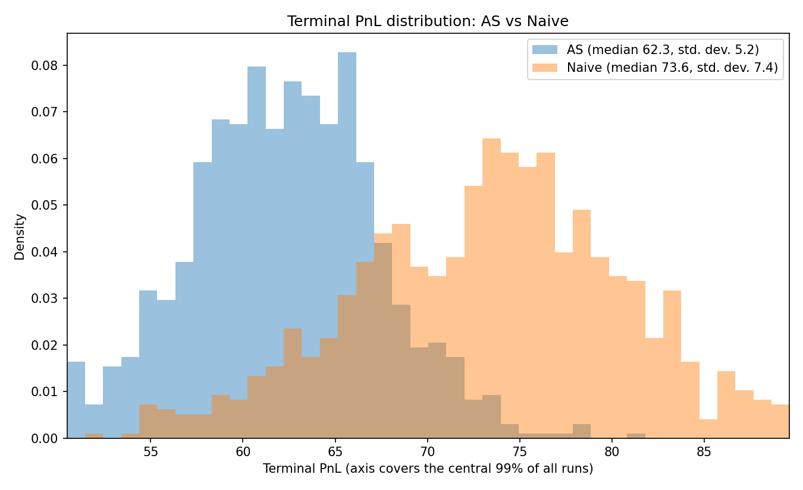
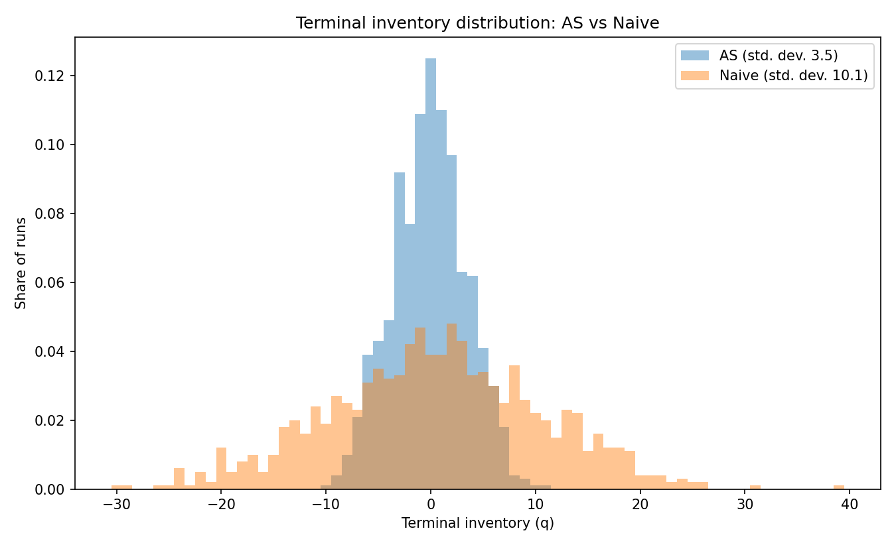
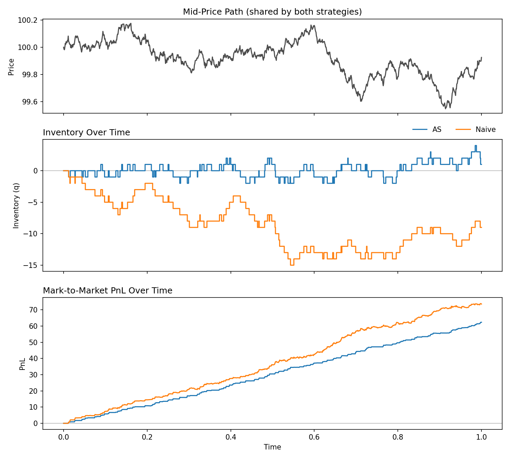
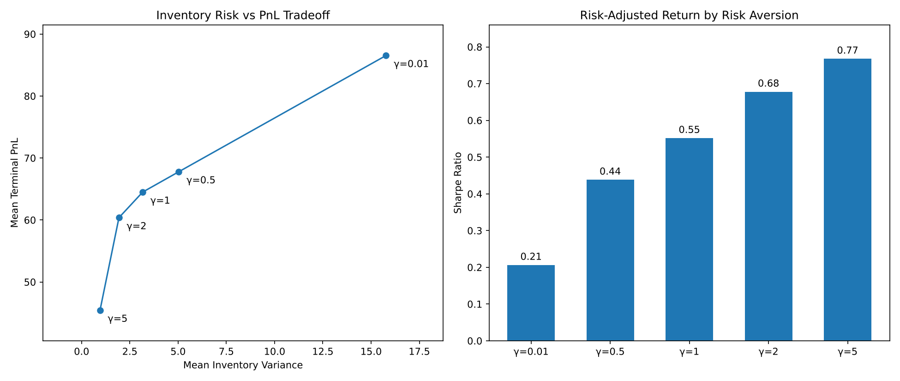
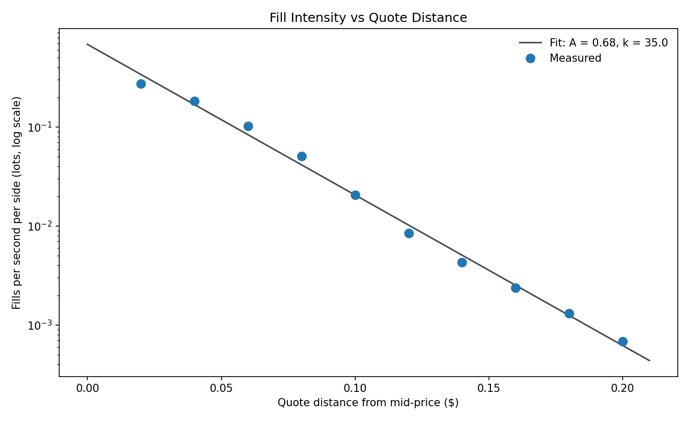
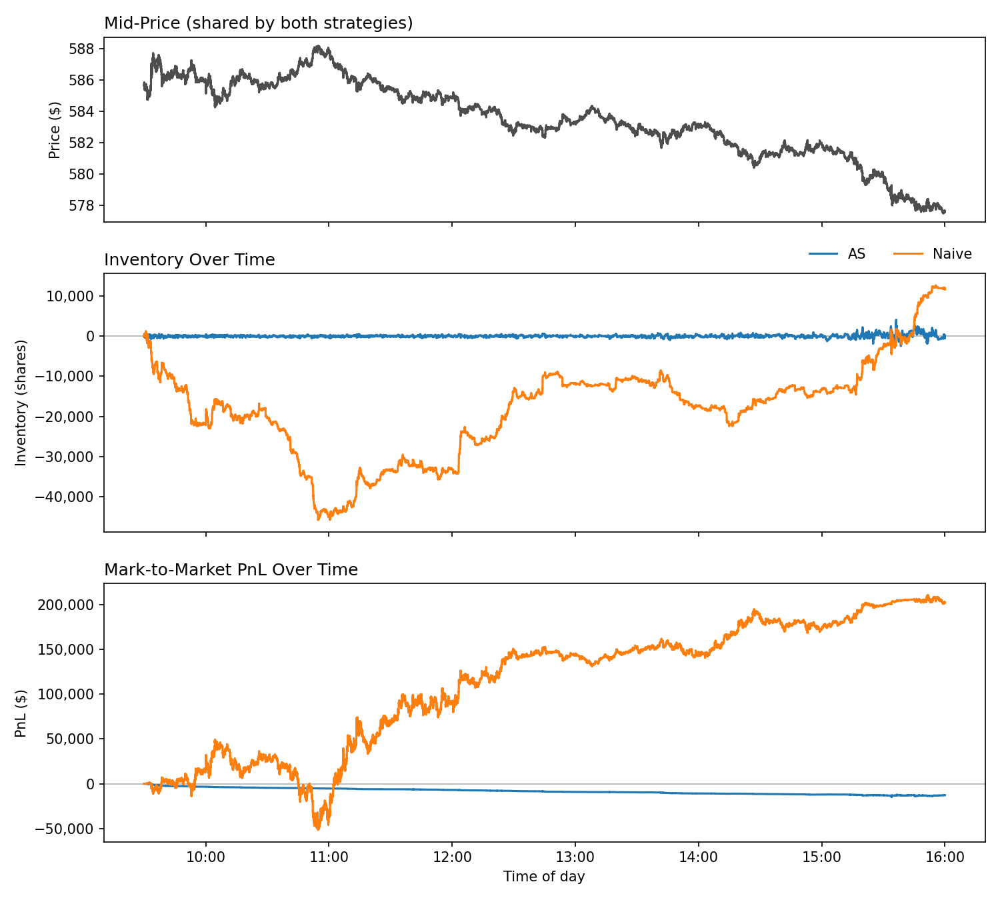
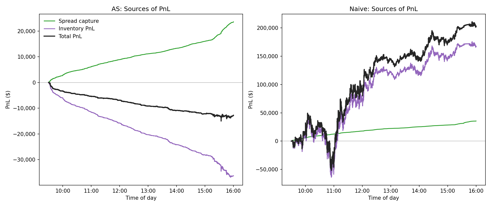

# avellaneda_stoikov_mm
A Monte Carlo simulation comparing an Avellaneda-Stoikov (AS) inventory-aware
market making strategy against a naive fixed-spread baseline, on a simulated
geometric Brownian motion (GBM) price path with Poisson order-arrival dynamics.

The AS strategy skews its quotes based on current inventory to actively manage
risk; the naive strategy quotes a constant spread around the mid-price
regardless of position. This project runs both strategies across a thousand
simulated price paths and measures the resulting trade-off between
profitability and inventory risk. It then replays both strategies against a
real day of NASDAQ order book data, to see how the model holds up outside its
own assumptions.

## Background
Market makers profit from the bid-ask spread, but every filled order changes
their inventory, exposing them to the risk that the price moves against the
position they're now holding. A market maker who only ever quotes a symmetric
spread around the mid-price does nothing to manage this.

Avellaneda and Stoikov's 2008 paper, *"High-frequency trading in a limit order
book"*, solves this with a closed-form optimal quoting strategy derived from a
stochastic control problem: a market maker with an exponential (CARA) utility,
facing a mid-price that follows Brownian motion and order arrivals that hit the
book with λ(δ) = A·e^(−kδ) at a distance δ from the mid.

The solution has two pieces:

- **Reservation price** - an inventory-adjusted "fair" price the market maker
quotes around, shifting below the mid-price when long and above it when short:

```
r(s, q, t) = s - q·γ·σ²·(T − t)
```

- **Optimal spread** - the total width quoted around the reservation price,
widening with volatility, time remaining, and risk aversion, and narrowing as
the order-flow intensity parameter k increases:

```
δ_a + δ_b = γ·σ²·(T − t) + (2/γ)·ln(1 + γ/k)
```

Here `γ` is the risk-aversion parameter: `γ → 0` collapses the strategy to the
naive symmetric quoter, while larger `γ` skews quotes more aggressively to push
inventory back toward zero, at the cost of some expected profit.

## What this project does

- Simulates a mid-price path via geometric Brownian motion and Poisson order
arrivals with exponential fill-intensity decay.
- Implements the AS reservation price, optimal spread, and quoting logic, and a
naive fixed-spread baseline sharing the same `quote_fn` interface.
- Runs single-path simulations and full Monte Carlo batches (1,000 paths) for
both strategies, using matched random seeds so any difference in outcome is
attributable to the quoting logic.
- Sweeps the risk-aversion parameter γ to trace out the inventory-risk vs. PnL
trade-off the AS paper predicts.
- Reports Sharpe ratios, terminal-PnL and inventory distributions, and
visualises all of the above.
- Backtests both strategies against one day of LOBSTER order book messages,
with fills decided by price-time priority against the real order flow.
- Estimates volatility and the fill-intensity parameters `A` and `k` from that
data, and compares the backtest with what the AS model predicts for the same
parameters.

## Results

Config used below: `s0=100, mu=0.0, sigma=0.005, T=1.0, n_steps=1000, A=150.0,
k=1.5`, AS strategy at `γ=2`, 1000 Monte Carlo paths per strategy. The naive
strategy quotes a fixed half-spread of 0.674, equal to the AS strategy's
half-spread at `t = 0`, when it is at its widest.

`sigma` is the GBM volatility, a fraction of the price. The AS formulas need
volatility in price units, so they use `sigma × s0 = 0.5`: the simulated price
moves by about 0.5 over the run, and that is the `σ` in the reservation price
and spread.

### AS vs. naive: profit and risk

| | AS (γ=2) | Naive |
|---|---|---|
| Mean terminal PnL | 62.2 | 73.4 |
| Median terminal PnL | 62.3 | 73.6 |
| Terminal PnL std. dev. | 5.2 | 7.4 |
| Sharpe ratio | **12.05** | 9.88 |
| Mean inventory variance (per path) | 1.94 | 16.86 |
| Terminal inventory std. dev. | 3.52 | 10.13 |

This matches the pattern in the original paper: the naive quoter earns a
*higher* average profit, with no regard for the risk it's accumulating. Its
fixed half-spread of 0.674 sits almost exactly at `1/k ≈ 0.667`, the distance
that maximises expected spread capture under the fill model `λ(δ) = A·e^(−kδ)`.
The AS strategy's half-spread narrows from 0.674 to 0.424 as `t → T`, so it
fills more often but earns less on each fill, and it skews its quotes away
from the profit-maximising distance whenever it holds inventory. It trades
that mean profit away in exchange for a reduction in inventory variance and PnL
variance. The net effect on risk-adjusted return (Sharpe ratio) favours the AS
strategy over the naive strategy.

Sharpe ratios this high are a property of the model, not of market making.
Simulated fills say nothing about where the price goes next, so spread income
is almost riskless. The backtest further down shows what happens when that
assumption fails.



The naive strategy's PnL distribution sits further right and is visibly wider;
the AS distribution is tighter around its mean, which is the direct consequence
of actively managing inventory rather than letting it drift. Both histograms
share the same bins and are scaled to densities so their heights are
comparable. The central 98% of naive outcomes runs from about 56 to 90, and the
AS strategy's from about 50 to 74.



The difference is clearer in inventory, which is what the AS strategy controls
directly. 87% of AS runs finish within 5 units of flat, against 42% of naive
runs, and the naive strategy's terminal inventory ranges from −30 to +39. The
effect on PnL is smaller than the effect on inventory because the price moves
little in this configuration: with a volatility of 0.5 in price units, even a
20-unit position typically gains or loses only about 10 over the run, against
roughly 70 of spread income.

### A representative single run



Both strategies are shown on the same simulated price path: the run whose
terminal PnL is closest to the median for both strategies at once, so neither
is having an unusually good or bad day. This makes the mechanism visible
directly. The AS strategy's inventory mean-reverts toward zero throughout the
session and stays between −2 and +4, while the naive strategy's inventory
drifts to −15 and stays short for the whole run. Both PnL paths climb
steadily, to 62 for AS and 74 for naive. The naive path is visibly rougher,
because its larger position is revalued with every move in the price.

### The γ sweep: risk aversion trades off against expected profit

| γ | Mean inventory variance | Mean terminal PnL | Terminal PnL std. dev. | Sharpe ratio |
|---|---|---|---|---|
| 0.01 | 15.78 | 73.4 | 7.3 | 10.07 |
| 0.5 | 5.04 | 71.2 | 6.1 | 11.61 |
| 1 | 3.17 | 68.3 | 5.8 | 11.84 |
| 2 | 1.94 | 62.2 | 5.2 | 12.05 |
| 5 | 0.96 | 47.0 | 4.1 | 11.47 |



Sweeping γ from 0.01 (near risk-neutral) to 5 (highly risk-averse) traces out
the trade-off directly: higher γ monotonically reduces both inventory variance
and mean PnL. Up to `γ=2`, PnL variability falls faster than mean PnL does, so
the Sharpe ratio rises from 10.07 to 12.05. Beyond that the profit given up
outweighs the further reduction in risk, and the Sharpe ratio falls back to
11.47 at `γ=5`.

## Backtest on real order book data

The simulation above tests the AS strategy inside its own model. The backtest
replays both strategies against real order flow: the LOBSTER sample file for
AAPL on 21 June 2012, which holds every message affecting the top five levels
of the NASDAQ book from 9:30 to 16:00 (301,587 messages). The mid-price fell
from 585.63 to 577.61 over the day, and the bid-ask spread averaged about 15
cents.

### How fills are decided

Each strategy keeps one bid and one ask of 100 shares in the book. Our orders
are assumed not to change the real order flow, and they are filled by the
exchange's price-time priority:

- If a real order is executed at a worse price than our quote, the incoming
order would have reached us first, so we are filled.
- At our own price, we are filled only when an order that joined the queue
after us is executed. Orders the file never shows arriving are treated as
ahead of us.
- A displayed order ranks ahead of a hidden order at the same price.
- Quotes are post-only: a quote that would cross the market is moved to one
tick inside the opposite best price.
- A quote whose price does not change keeps its place in the queue.
- Quotes are updated with no latency, but never between messages that share a
timestamp, because those are one incoming order sweeping the book.

Fills happen at our own quote price, and inventory left at the close is marked
at the final mid-price. Inventory is passed to the AS formulas in lots of 100
shares, because the model is written for fills of one unit.

### Parameters estimated from the data

| Parameter | Value | How it is estimated |
|---|---|---|
| `σ` | 0.0353 dollars per root second | Standard deviation of one-second mid-price changes |
| `A` | 0.683 lots per second | Fit of `λ(δ) = A·e^(−kδ)` to measured fill rates |
| `k` | 35.0 per dollar | Same fit |
| `γ` | 0.001 | Chosen by hand |

To measure fill rates, the session is replayed ten times with quotes pegged
between 2 and 20 cents from the mid-price, counting the fills at each
distance. The exponential form assumed by the paper is a reasonable fit to
those rates:



With these parameters the AS half-spread narrows from 4.3 cents at the open to
2.9 cents at the close, and one lot of inventory moves the reservation price
by 2.9 cents at the open. The naive strategy quotes a fixed 4.3 cents either
side of the mid-price, the AS strategy's opening half-spread.

### Results

| | AS (γ=0.001) | Naive |
|---|---|---|
| Final PnL ($) | −12,710 | 202,690 |
| of which spread capture ($) | 23,569 | 35,468 |
| of which inventory PnL ($) | −36,279 | 167,223 |
| Sharpe ratio of one-minute PnL changes | −0.220 | 0.090 |
| Inventory std. dev. (shares, time-weighted) | 378 | 11,839 |
| Largest position (shares) | 4,223 | 45,832 |
| Fills | 11,571 | 13,061 |
| Shares traded | 681,806 | 750,398 |

Spread capture is what each fill earns by trading away from the mid-price it
was quoted from. Inventory PnL is everything else: the gain or loss from
holding the position while the mid-price moves.



**The AS strategy controls inventory as the model says it should.** Its
position has a standard deviation of 378 shares against 11,839 for the naive
strategy, and it stays within 2,241 shares until 15:30. It then swings as far
as 4,223 shares in the last half hour, when the `(T − t)` term has shrunk the
inventory skew towards zero. This is the end-of-horizon effect described under
Limitations.

**It still loses money, because of adverse selection.** The strategy earns 3.5
cents a share in spread capture and loses 5.3 cents a share on the inventory
it takes on. Orders that hit a quote tend to arrive just before the price
moves against it, so the position is worth less than was paid for it almost
immediately.



**The model does not see that loss coming.** Simulating the AS strategy under
its own assumptions, with the same `σ`, `A`, `k` and `γ`, gives a median PnL of
$30,290 (5th to 95th percentile: $28,881 to $31,663). The real result of
−$12,710 is below every one of the 200 simulated runs. In the model, fills
arrive at random and say nothing about where the price goes next, so spread
capture is nearly pure profit. The fitted `k` therefore tells the strategy to
quote about 3 to 4 cents from the mid-price, inside a spread that averages 15
cents, where it trades with exactly the orders that move the price.

**The naive strategy's profit is a directional bet it did not choose.** Of its
$202,690, $167,223 is inventory PnL. It was short 45,832 shares (about $27
million of stock) and down $51,729 at 10:54, and recovered because AAPL then
fell for the rest of the day. Nothing in the strategy chose that position or
limited it.

### What the backtest leaves out

- **One day, fitted in-sample.** `σ`, `A` and `k` are estimated from the same
day the strategies are tested on, and one day says little about other days.
- **No market impact.** The real order flow is replayed unchanged, although
the AS strategy trades about 24% of the 2.85 million shares executed in the
file. Real participants would have reacted to quotes that size.
- **No latency.** Quotes are updated the instant the book changes.
- **No fees or rebates.** Exchanges typically pay a rebate for providing
liquidity, which would offset part of the AS strategy's loss.
- **Partial view of the book.** The file covers five price levels and starts
at the open, so the arrival time of some resting orders is unknown. They are
assumed to be ahead of us in the queue, which can only delay our fills.

## Limitations
This project simulates the AS model faithfully, but the model carries some
simplifications.

- **End-of-horizon inventory risk.** Both the reservation-price skew and the
risk-widening term of the spread are scaled by `(T - t)`:

  ```
  r(s, q, t) = s − q·γ·σ²·(T − t)
  δ_a + δ_b  = γ·σ²·(T − t) + (2/γ)·ln(1 + γ/k)
  ```

  As `t → T`, both terms vanish - the reservation price collapses back to the raw
  mid-price regardless of inventory, and the spread narrows to just its fixed
  liquidity term. The strategy effectively stops managing inventory risk right as
  the horizon closes, since the model's utility function assigns no cost to
  holding inventory at the exact instant `t = T`. In practice, this can produce a
  sharp, uncorrected inventory swing in the final steps of a run, visible in the
  representative-run plot above. Guéant, Lehalle & Fernandez-Tapia (2013) address
  this issue with an explicit terminal inventory penalty or hard liquidation
  constraint forcing `q → 0` as `t → T`.

- **Simulated order flow.** Fills are generated from a Poisson process with
intensity `λ(δ) = A·e^(−kδ)`, as in the original paper, rather than from actual
order-book depth, queue position, or competing market makers. Real fill rates
depend on factors this model doesn't capture, like adverse selection and queue
priority. The backtest above replaces the simulated fills with real order flow,
and adverse selection turns out to decide the result.

- **Geometric Brownian motion.** The mid-price follows GBM with constant
`mu`/`sigma`, which ignores volatility clustering, jumps, and mean reversion
seen in real intraday prices. The AS formulas assume a constant volatility in
price units, which is matched to the GBM volatility at the initial price.

- **No transaction costs or fees.** PnL is computed from fills alone; exchange
fees, rebates, and slippage aren't modeled.

- **Simulation parameters are illustrative.** In the Monte Carlo simulation,
`A`, `k`, `sigma`, and `mu` are set to values in a realistic range but weren't
fit to a specific real asset's order-flow or price data. Only the backtest
estimates them from data.

## Usage

Create a virtual environment and install the dependencies:

```bash
python3 -m venv venv
source venv/bin/activate
pip install -r requirements.txt
```

Run the full AS vs. naive comparison, including the γ sweep, followed by the
order book backtest. Each plot is displayed and also saved to `assets/graphs/`.
The whole run takes about a minute:

```bash
python main.py
```

Run the test suite:

```bash
pytest
```

Run the linter:

```bash
pylint src tests
```

## Project structure

```
avellaneda_stoikov_mm/
├── main.py
├── requirements.txt
├── .pylintrc
├── assets/
│   ├── graphs/
│   │   ├── pnl_distribution.png
│   │   ├── inventory_distribution.png
│   │   ├── representative_run.png
│   │   ├── gamma_sweep.png
│   │   ├── fill_intensity.png
│   │   ├── backtest_comparison.png
│   │   └── backtest_pnl_decomposition.png
│   └── lobster/
│       ├── AAPL_2012-06-21_34200000_57600000_message_5.csv
│       └── AAPL_2012-06-21_34200000_57600000_orderbook_5.csv
├── src/
│   ├── config.py
│   ├── market.py
│   ├── quoting.py
│   ├── naive_quoting.py
│   ├── simulation.py
│   ├── monte_carlo.py
│   ├── sweep.py
│   ├── analysis.py
│   ├── plotting.py
│   └── backtest/
│       ├── lob_data.py
│       ├── lob_replay.py
│       ├── strategy_runner.py
│       ├── backtest_analysis.py
│       └── run_backtest_comparison.py
└── tests/
```

## Data
The order book data is the sample file published by LOBSTER (lobsterdata.com)
for AAPL on 21 June 2012, at five levels of depth.

## References
Avellaneda, M., & Stoikov, S. (2008). High-frequency trading in a limit order
book. *Quantitative Finance*, *8*(3), 217–224.
https://doi.org/10.1080/14697680701381228

Guéant, O., Lehalle, C.-A., & Fernandez-Tapia, J. (2013). Dealing with the
inventory risk: A solution to the market making problem. *Mathematics and
Financial Economics*, *7*(4), 477–507.
https://doi.org/10.1007/s11579-012-0087-0

Harper, D. (2025, October 14). Monte Carlo Simulation With Geometric Brownian
Motion Explained. Investopedia.
https://www.investopedia.com/articles/07/montecarlo.asp
